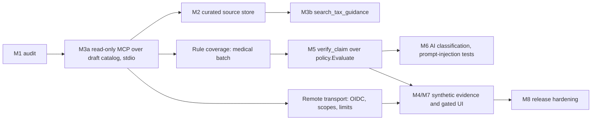

# Repository audit for the tax-relief MCP server

Date: 2026-11-07. Base: `origin/main` at `14cd0c0`. Brief: `TAX_RELIEF_MCP_MASTER_PROMPT.md` §19.
Developer preview. Not tax advice. Not affiliated with LHDN. Nothing in this repository is an approved tax rule.

This file answers the ten audit items in §19. It extends `docs/MCP_CONNECTOR_PLAN.md` and `docs/ROADMAP.md`; it does not replace them.

## 1. Structure and technologies

| Area | Path | Notes |
|---|---|---|
| API | `services/api` | Go module `github.com/fikrimastor/mytax/services/api`, `go 1.23.0` at audit time (1.25.0 after this increment). Echo v4, pgx v5, go-oidc v3. One binary, `cmd/server`, all routes flat in `main()`. |
| Rules and engine | `internal/policy` | `YA2025Draft()` (10 rules, 3 shared groups, 1 exclusive family), `Evaluate`, `CanonicalFacts` (25), `ReliefRegistry2025()` (31 descriptive entries), `ValidateRelease`, `ActivePackage` (always errors). |
| Other tax code | `internal/calculation`, `assessment`, `reconciliation`, `formbe`, `income`, `family`, `tax` | Gross tax YA2025, provisional rebates, review-only dividend check, preview and worksheet flows. `family` is not wired to any route. `tax` is a legacy gate that trusts client booleans. |
| Evidence | `internal/evidence` | In-memory, synthetic metadata only. Duplicate digest/invoice detection and a SHA-256 hash chain. No storage, no tenancy. |
| Security | `internal/security`, `internal/persistence`, `migrations/` | OIDC access-token verifier, one protected route behind `MYTAX_ENABLE_AUTH_PREVIEW`, RLS on 4 tables, SELECT-only app role (plus INSERT on `evidence_metadata`). |
| Frontend | `apps/web` | Nuxt 3, Nuxt UI. Not in CI. |
| CI | `.github/workflows/api.yml` | One job: PostgreSQL 16 + Keycloak 26 containers, `go mod tidy` diff check, `go test -race`, fails on any skipped test, asserts both live Keycloak tests ran. |
| Deployment | `docker-compose.yml`, `services/api/Dockerfile` | Coolify. Preview flags unset. Live deployment not verified. |

## 2. Instructions from `AGENTS.md` and `CLAUDE.md`

`CLAUDE.md` points to `AGENTS.md`. The rules that shape the MCP work:

- One engine. Reuse `internal/policy`; never a parallel calculation.
- Fail closed. Unknown, unapproved or unsupported cases are `REVIEW_REQUIRED` with a zero amount. Draft rules never reduce chargeable income.
- No YA copying. A YA 2025 rule is not a YA 2026 rule.
- Integer sen.
- OCR, an LLM, user flags or receipts never establish eligibility.
- No real taxpayer data until tenancy, encrypted storage, malware scanning, retention, audit logging, PDPA review and negative isolation tests are in place.
- Report committed, locally tested, CI passed, live tested and reviewed separately.

## 3. Tax calculation and policy capability

- **Engine**: `policy.Evaluate(p Package, claims []Claim) (Result, error)`. Rejects any YA except 2025. Sorts claims by ID, so the lower ID wins a contested cap. Duplicate `expense_key` fails closed; missing `evidence_reference` fails closed; caps apply as `min(rule remaining, group remaining)`; exclusive family `FIRST_HOME`. Statuses: `REVIEW_REQUIRED`, and `POLICY_APPROVED_PRELIMINARY` only for an `Approved` package. `FilingReady` is never true.
- **Reason codes** (string literals in `engine.go`): `UNKNOWN_RELIEF_RULE`, `EXPENSE_IDENTIFIER_MISSING`, `DUPLICATE_EXPENSE`, `EVIDENCE_MISSING`, `MUTUALLY_EXCLUSIVE_RELIEF`, `UNVERIFIED_FACT:<fact>`, `DRAFT_POLICY_NOT_APPROVED`, `LIMIT_REACHED`.
- **Rules**: 10 draft rules (lifestyle x4, vaccination, dental, education x2, first home x2). 21 of the 31 registry entries have no rule yet, including the medical batch, sports, childcare, SSPN, insurance, EPF, PRS, SOCSO.
- **Approval**: no approved package exists. `ValidateRelease` is structural only (no signature or trust anchor). `ActivePackage` always returns an error.
- **Tests**: 39 policy tests and a 24-case recorded fixture (`policy/testdata/relief_cases.json`). No official LHDN golden fixtures.

## 4. Evidence, source management and security

- **Sources**: per rule, `Source{URL, Section, RetrievedOn}`. Hashes of the source texts live only in docs (`docs/sources/act53/README.md`, `docs/YA2025_SOURCE_RECONCILIATION.md`). No machine-readable source store, no per-rule hash, no reviewer field.
- **Evidence**: synthetic metadata prototype only; endpoint disabled by default.
- **Auth**: signature, alg, iss, aud, exp, nbf, token type, `azp`/`client_id`, exact scope are verified. Gaps: no JWKS rotation test, no revocation or introspection, one configurable scope, `client_id` fallback accepted when `azp` is absent.
- **Tenancy**: `WithTenant` sets a transaction-local subject, checks membership, then RLS applies. Two-tenant, concurrency, spoofing and leakage tests pass in CI with live PostgreSQL and Keycloak.
- **Audit**: `audit_events` exists but the app role cannot insert, by design (`security/migrations_test.go`).
- **Missing**: rate limits, body caps, request timeouts, structured logs, document storage, persistence of claims or evaluations.

## 5. Gaps for MCP integration

1. No Go MCP server and no MCP dependency in `go.mod`.
2. The untracked `tax-relief-mcp/` folder (TypeScript, never in git) was a second rule table and calculator: float RM, keyword matching, `applicable_years: [2024, 2025, 2026]`, statuses `ELIGIBLE`/`PARTIALLY_ELIGIBLE`, messages such as "Claim of RM… accepted", sub-caps not enforced, no citations, no `REVIEW_REQUIRED`, "production-ready" wording. It broke the one-engine, fail-closed and no-YA-copy rules. **Deleted on 2026-11-07 at the owner's request.**
3. No YA resolver: the literal `2025` appears in the policy engine and in eight other places.
4. No curated, searchable source passages, so `search_tax_guidance` has nothing approved to search.
5. No auth model for a remote MCP transport: no per-tool scopes, no OAuth protected-resource metadata.
6. No persistence for claims, evaluations or tool-call audit.

## 6. Minimal recommended migrations

None for the first increment. The read-only MCP tools serve the in-code draft catalog, the same data `GET /v1/policy/catalog` already serves publicly.

Later, in order, each behind its own review:
1. `tax_sources` (id, title, authority, URL, document type, YA, retrieval date, SHA-256, review state) and `tax_rule_citations` linking rule versions to a source and section. Needed before `search_tax_guidance`.
2. `claim_evaluations` (tenant, package version, input digest, result JSON, created at) with RLS and an INSERT-only grant. Needs a change to the migration safety test and a review of the audit design.
3. An `audit_events` writer. Today the safety test forbids it on purpose.
Documents, extractions and expenses wait for the storage, malware and PDPA gates.

## 7. MCP design and tool contracts

One shared engine. The MCP server is a thin adapter over `internal/policy`; REST and MCP call the same functions.

| Tool | Milestone | Input | Output | State |
|---|---|---|---|---|
| `list_tax_reliefs` | 3 | `assessment_year` | Package version and status, groups, engine rules, descriptive registry entries, notice | **Implemented (stdio)** |
| `get_tax_relief_rule` | 3 | `assessment_year`, `rule_id` | Rule, group cap, exclusive family, required facts, claim fields the engine requires, sources, notice | **Implemented (stdio)** |
| `search_tax_guidance` | 3 | `assessment_year`, `query` | Cited passages from curated sources | Blocked: needs migration 1 and approved passages |
| `get_required_evidence` | 4-5 | `assessment_year`, `rule_id` | Facts and documents still outstanding for a claim | Planned |
| `classify_expense` | 6 | Structured expense facts | Advisory candidate rule IDs only, never eligibility | Planned |
| `verify_claim` / `calculate_tax_reliefs` | 5 | Structured claims | `policy.Evaluate` result unchanged | Planned; same as `POST /v1/eligibility/preview` |
| `generate_claim_report` | 5-7 | Evaluation reference | Auditable summary | Needs persistence |

Rules for every tool:
- No `user_id`, `tenant_id` or authorization field in any schema. Identity comes only from a verified token (remote transport, later).
- An unsupported YA or unknown rule is a tool error with `RULE_UNAVAILABLE` or `UNKNOWN_RELIEF_RULE`; nothing is guessed.
- Every result carries the package status and a notice that nothing is approved or filing-ready.
- Transport: stdio only for now (local, no network listener, public draft data only). A streamable HTTP transport needs gate P2 in `docs/MCP_CONNECTOR_PLAN.md`: OIDC bearer validation reusing `security.AccessVerifier`, per-tool scopes, rate limits, body caps.
- SDK: official `github.com/modelcontextprotocol/go-sdk` v1.8.0 (checked 2026-11-07). It needs Go 1.25, so `go.mod` and the Dockerfile move from 1.23 to 1.25; SDK v1.3.1 is the last release on Go 1.23 and lacks the newer protocol versions. Its `auth.RequireBearerToken` checks one scope set for the whole endpoint; per-tool scopes must be checked inside each tool handler from `auth.TokenInfoFromContext`.
- Schema behaviour to keep in mind: `jsonschema` struct tags are descriptions only; inferred input schemas reject unknown properties; an output that fails its schema is a protocol error, so outputs never contain `null` where an array is declared.

## 8. Security and tax compliance gates

| Gate | Unlocks | State |
|---|---|---|
| CI green with live PostgreSQL and Keycloak | Any MCP code | Met on `main` (PR #4) |
| JWKS rotation test, revocation decision, per-tool scopes | Remote MCP transport | Open |
| Rate limits, body caps, timeouts, safe logs on the MCP path | Remote MCP transport | Open |
| Curated source store with hashes and review state | `search_tax_guidance` | Open |
| Rule coverage for common receipt categories (medical batch first) | Useful `verify_claim` | Open |
| Persistence with RLS and audit writer | Cross-session duplicates, reports | Open |
| Encrypted storage, malware scan, retention, PDPA review | Any real document | Open |
| Tax-professional review and LHDN golden fixtures | Any approved package | Open |
| Independent threat review or penetration test | Any real user | Open |

## 9. Milestone sequence

## 10. Open questions and risks

| # | Item | Owner decision or action |
|---|---|---|
| 1 | Delete `tax-relief-mcp/` (TypeScript parallel engine)? | Done: deleted 2026-11-07 by owner decision. |
| 2 | Hosting, domain and transport for remote MCP | Owner (open question 1 in the connector plan) |
| 3 | Data controller and AI provider role under PDPA | Owner and counsel |
| 4 | Do receipt images ever reach our server? | Owner; the plan assumes no |
| 5 | User-facing notice language (Malay, English, both) | Owner |
| 6 | `client_id` fallback when `azp` is absent | Security review |
| 7 | Reason codes are string literals; MCP clients depend on them | Export them as constants when `verify_claim` lands |
| 8 | Model presents a draft amount as an entitlement | Every result carries status and notice; no approve path exists |
| 9 | Prompt injection through receipts or source text | Tools are read-only now; injection tests are part of M6 |
| 10 | Rule coverage is 10 of 31 entries | Medical batch next; unsupported categories return `UNKNOWN_RELIEF_RULE` |

## Increment delivered with this audit

Milestone 3a: a local stdio MCP server, `services/api/cmd/mcp`, with `list_tax_reliefs` and `get_tax_relief_rule` over `policy.DraftPackage` and `policy.ReliefRegistry2025`. No network listener, no taxpayer data, no new calculation, no write tool. See `docs/MCP_SERVER.md`.
